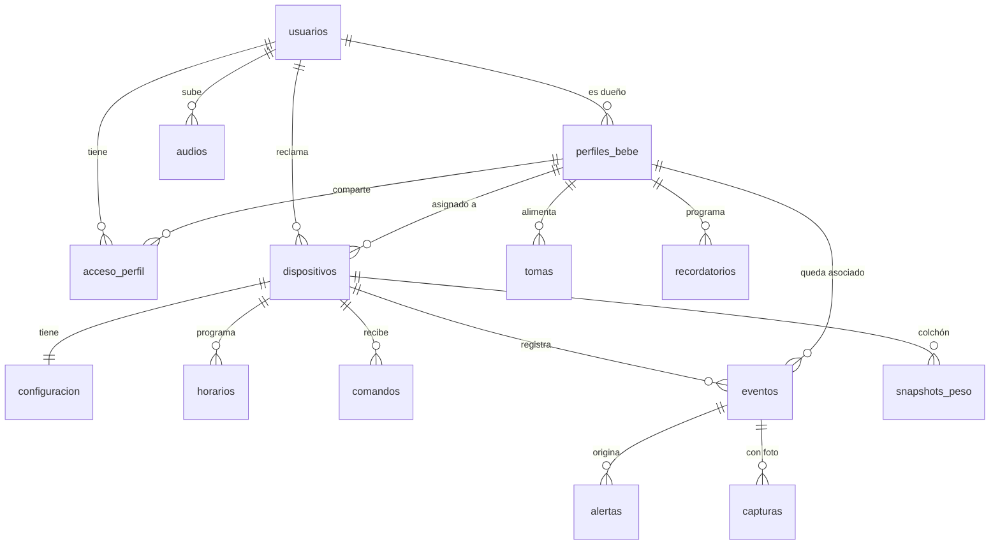

# Base de datos (Fase 0 · Sprint 3)

Responsable: **Andrés Guzmán (AG)**

PostgreSQL en Supabase. Este documento es el contrato entre la base de datos, la
app y los dispositivos.

---

## Archivos

```
supabase/
├── migrations/
│   ├── 20261101000000_esquema_base.sql         ← 14 tablas e índices
│   ├── 20261101000100_funciones_y_triggers.sql ← lógica, alertas y vistas
│   ├── 20261101000200_seguridad_rls.sql        ← permisos y RLS
│   ├── 20261101000300_storage_y_realtime.sql   ← buckets y publicación Realtime
│   └── 20261101000400_tareas_programadas.sql   ← pg_cron
├── config.toml                                 ← Supabase local: puertos y contraseña
└── seed.sql                                    ← 6 dispositivos y 1 perfil de prueba
pruebas/
├── 02_verificar_base_datos.sql                 ← ⚠️ solo en una base local
├── 03_probar_servicios.py                      ← ⚠️ solo en una base local
└── requirements.txt
TUTORIAL_PRUEBAS_DOCKER.md                      ← cómo correr todas las pruebas
```

---

## Instalación en el proyecto oficial

1. Activar **`pg_net`** en Dashboard → Database → Extensions. `pg_cron` lo activa
   la migración 5.
2. Ejecutar las migraciones en orden, con `supabase db push` o en el SQL Editor.
3. Ejecutar la migración de Telegram (`20261101120000_notificaciones_telegram.sql`).
   `supabase db push` solo lee `supabase/migrations/`, y hoy ese archivo está en
   `SPRINT 3/supabase/` de la rama de Telegram: hay que moverlo allí.
4. Crear las cuatro cuentas que indica `supabase/seed.sql` y ejecutar ese archivo.
5. En Authentication → Providers → Email, poner la longitud mínima de contraseña en
   **8** (CA-01.1). Ese ajuste no viaja con las migraciones: `supabase/config.toml`
   solo lo aplica en local. Decidir también si se deja activa la confirmación por
   correo, porque en local está apagada.

---

## Modelo de datos



| Tabla | Para qué | Historias |
|---|---|---|
| `usuarios` | Cuenta, rol y chat de Telegram. Se crea sola al registrarse | HU-01, HU-37 |
| `perfiles_bebe` | Perfil con borrado lógico (`eliminado_en`) | HU-03 |
| `acceso_perfil` | Quién ve cada perfil y quién puede controlarlo | CA-17.1, CA-18.2 |
| `dispositivos` | Código, tipo, dueño, perfil, señal y última lectura | HU-04 a HU-06 |
| `configuracion` | Una fila por dispositivo: umbrales, luz, móvil, seguridad, juego | HU-09, 11, 15, 20, 21, 23, 31, 33 |
| `horarios` | Móvil, seguridad y ventanas de movimiento | HU-10, HU-22, HU-23 |
| `comandos` | Órdenes puntuales de la app al dispositivo | HU-07, 13, 15, 18 |
| `eventos` | Lecturas y eventos: es el historial | HU-08, 39, 40 |
| `alertas` | Lo que se envía por Telegram | HU-09, 16, 17, 24 a 27, 33, 36, 38 |
| `snapshots_peso` | Peso base de cada siesta | HU-15, HU-18 |
| `capturas` | Fotos vinculadas a su evento | HU-26, HU-28 |
| `tomas` | Inicio, fin, duración y mililitros | HU-34, HU-35 |
| `recordatorios` | Por intervalo o a hora fija | HU-36 |
| `audios` | MP3 de la cuna | HU-13 |

---

## Contrato para los dispositivos

Cada **controlador** inicia sesión en Auth con su propia cuenta. Si un controlador
maneja varios dispositivos, usa la misma cuenta para todos. Al arrancar, obtiene
sus ids con `select id, codigo from dispositivos`.

| Qué | Cómo | Cuándo |
|---|---|---|
| Señal y vista en vivo | `rpc('registrar_senal', {p_dispositivo, p_lectura})` | Cada 5 s |
| Muestra para el historial | `insert` en `eventos` | Cada minuto |
| Evento | `insert` en `eventos` | Al ocurrir |
| Recibir órdenes | Realtime en `comandos` (filtrar por `dispositivo_id`) | Siempre |
| Marcar una orden | `update comandos set estado, resultado, ejecutado_en` | Al terminar |
| Recibir ajustes | Realtime en `configuracion`. Leerla también al arrancar (CA-11.3) | Siempre |

El colchón manda `{"conectado_cuna": true}` o `false` dentro de `p_lectura` (CA-14.2).

Al reenviar el buffer sin conexión, hay que conservar el `ocurrido_en` original e
insertar con `upsert(..., ignore_duplicates=True)`. Así un evento reenviado no se
duplica (RNF-17).

### Eventos

Solo insertan `dispositivo_id`, `tipo`, `valor`, `unidad`, `descripcion`,
`foto_path` y `ocurrido_en`. El perfil lo pone el trigger.

| `tipo` | `valor` | Qué hace el trigger |
|---|---|---|
| `temperatura`, `humedad` | °C, % | Compara con los umbrales y alerta; repite cada `alerta_repeticion_min` |
| `temperatura_biberon` | °C | Alerta "Demasiado caliente" o "Demasiado fría" |
| `peso` | g | Solo guarda |
| `movimiento` | | Fuera de la ventana **se descarta**; dentro, guarda y alerta |
| `puerta`, `presencia` | | Con seguridad desarmada **se descarta**; armada, guarda y alerta |
| `alarma_antirrobo` | peso actual en g | Calcula el % perdido y crea la alerta crítica |
| `juguete_acierto`, `sistema` | | Solo guarda |

**No inserten la alerta además del evento**: saldrían dos mensajes. El trigger ya
la crea para estos tipos. Insertar directamente en `alertas` queda solo para
casos que no sean estos.

### Modo siesta

1. La app inserta el comando `activar_siesta`.
2. El colchón promedia el peso e inserta `{dispositivo_id, peso_base_g}` en `snapshots_peso`.
3. Si el peso no alcanza, el insert falla con `No se detecta al bebé`. El colchón
   marca el comando como `fallido` y pone ese mensaje en `resultado`, y la app lo muestra.
4. Si cae el peso, el colchón suena **sin consultar a la base** (RNF-16) e inserta
   el evento `alarma_antirrobo`.
5. Al recibir el comando `desactivar_siesta`, apaga el buzzer.

### Foto de evidencia

1. Subir a `capturas/<dispositivo_id>/<archivo>.jpg`: JPEG de 150 KB como máximo.
2. Insertar el evento `presencia` o `puerta` con esa ruta en `foto_path`.

El trigger crea la captura y la alerta con foto en una sola transacción.

---

## Contrato para la app

| Acción | Cómo |
|---|---|
| Registrarse e iniciar sesión | Supabase Auth; `usuarios` se llena solo |
| Listar perfiles | `perfiles_bebe` con `eliminado_en=is.null` (CA-03.1) |
| Crear perfil | `insert {propietario_id: <mi id>, nombre, fecha_nacimiento}` |
| Eliminar perfil | `rpc('eliminar_perfil', {p_perfil})` |
| Compartir perfil | `rpc('compartir_perfil', {p_perfil, p_correo, p_puede_controlar})` |
| Registrar dispositivo | `rpc('registrar_dispositivo', {p_codigo, p_nombre})` |
| Asignar o reasignar | `update dispositivos set perfil_id` |
| Luz, móvil, armar seguridad, umbrales, juego | `update configuracion` |
| Audio, activar siesta, pruebas | `insert` en `comandos` |
| Desactivar siesta | `rpc('desactivar_siesta', {p_dispositivo})` |
| Historial y CSV | Vista `v_historial`, orden `ocurrido_en.desc`, de 50 en 50 |
| Galería | Vista `v_galeria` y URLs firmadas |
| Aviso de Telegram (CA-37.2) | `usuarios.telegram_chat_id` es `NULL` |

`update` no da error si RLS filtra la fila: devuelve 0 filas. Hay que revisarlo
para avisar que faltó permiso. Las funciones sí devuelven el mensaje en español.
Una regla de `check` devuelve el código `23514` con el nombre de la regla, por
ejemplo `configuracion_rango_temperatura` (CA-09.3); la app lo traduce a un mensaje.

---

## Valores establecidos por el desarrollador

Están en `configuracion`, salvo el rango del biberón, que se asigna en
`crear_configuracion()`. Son una propuesta para calibrar con la maqueta.

| Valor | Por defecto | Requisito |
|---|---|---|
| Temperatura de la cuna | 18 a 26 °C | CA-09.4 |
| Humedad de la cuna | 40 a 60 % | CA-09.4 |
| Repetición de una alerta | 10 min | CA-09.2 |
| Temperatura del biberón | 35 a 40 °C | CA-33.1 |
| Peso mínimo para la siesta | 500 g | CA-15.2 |
| Caída de peso para la alarma | 30 % | CA-16.1 |
| Intervalo entre fotos | 30 s | CA-26.3 |
| Tiempo por ronda del juguete | 10 s | CA-30.3 |
| Fuera de línea | 60 s sin señal | CA-06.1 |
| Foto / MP3 | 150 KB / 5 MB | RNF-05, CA-13.2 |
| Retención | 90 días | RNF-25 |

---

## Pruebas

Se corren con Supabase completo en Docker: ver
[TUTORIAL_PRUEBAS_DOCKER.md](TUTORIAL_PRUEBAS_DOCKER.md).

- `pruebas/02_verificar_base_datos.sql`: 135 verificaciones de la lógica en SQL.
- `pruebas/03_probar_servicios.py`: 43 verificaciones con Auth, API, Storage,
  Realtime y pg_cron reales.

---

## Pendientes

- **Envío a Telegram**: el trigger sobre `alertas`, `pg_net` y los reintentos
  pertenecen a la migración de Telegram.
- **Borrado de fotos antiguas**: `purgar_historial()` conserva lo que tiene foto,
  porque los archivos solo se borran con la API de Storage. Falta una Edge Function
  que los elimine a los 90 días.
- **Alertas sin perfil**: de un dispositivo sin asignar quedan guardadas, pero el
  trigger de Telegram no tendrá destinatarios (`sin_destinatarios`).
